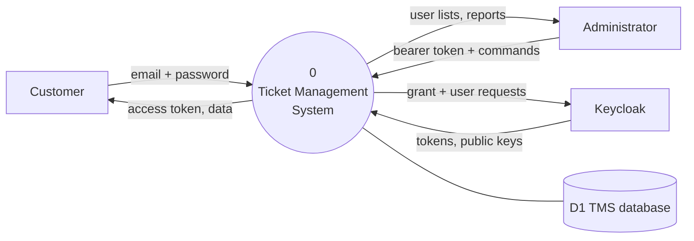
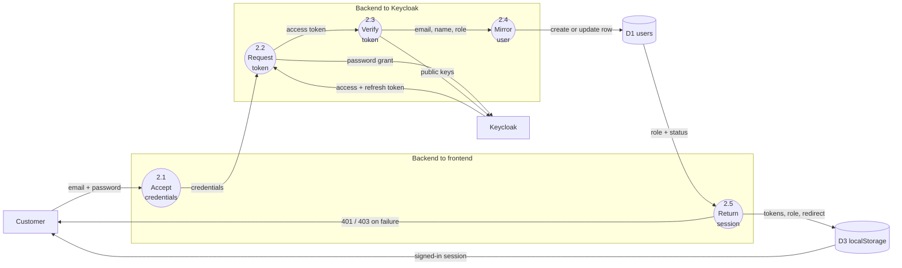

# How everything is wired together

Four parts. **Keycloak owns identity** (passwords, roles, tokens); the **API owns the
business domain** (movies, bookings, tickets); the **UI never talks to Keycloak** — it only
knows the API, which fronts Keycloak for it.

| Part | Tech | Port |
| ---- | ---- | ---- |
| Ticket UI | React + Bootstrap | 8081 |
| Ticket API | Spring Boot | 8010 |
| Keycloak | realm `ticket-realm` | 8080 |
| PostgreSQL | business data + user mirror | 5433 |

---

## DFD Level 0 — context

---

## DFD Level 1 — main processes

```mermaid
flowchart TB
    CUST["Customer"]
    ADMIN["Administrator"]
    KC["Keycloak"]

    P1(("1.0<br/>Register"))
    P2(("2.0<br/>Authenticate"))
    P3(("3.0<br/>Serve request"))
    P4(("4.0<br/>Moderate account"))

    D1[("D1  users")]
    D2[("D2  bookings, tickets")]

    CUST -->|"name, email, password"| P1
    P1 -->|"create user + role"| KC
    P1 -->|"mirror row"| D1

    CUST -->|"email, password"| P2
    P2 -->|"password grant"| KC
    KC -->|"tokens"| P2
    P2 -->|"upsert"| D1
    P2 -->|"access + refresh token"| CUST

    CUST -->|"bearer token"| P3
    P3 -->|"verify token"| KC
    P3 -->|"read / write"| D2
    P3 -->|"read"| D1
    P3 -->|"JSON"| CUST

    ADMIN -->|"suspend user"| P4
    P4 -->|"status"| D1
    P4 -->|"disable account"| KC
```

---

## DFD Level 2 — 2.0 Authenticate

Decomposes login, which is where both hops happen: **UI → backend** on the left,
**backend → Keycloak** on the right.

| Process | Does | Code |
| ------- | ---- | ---- |
| 2.1 | Takes `POST /login` from the UI | `AuthController` |
| 2.2 | Password grant against Keycloak | `KeycloakAdminClient` |
| 2.3 | Checks the signature and issuer of the token | Spring resource server |
| 2.4 | Creates or realigns the local `users` row | `UserService` |
| 2.5 | Returns tokens + role, or 401/403 | `AuthController` |

---

## Notes

- The UI sends `Authorization: Bearer <access_token>` on every call after login.
- Realm roles map to authorities: `admin` → `ROLE_ADMIN`, `customer` → `ROLE_CUSTOMER`.
- The `users` table is a **mirror**, not a credential store — it exists so bookings and
  tickets have a row to point at. No password is stored there.
- The UI must run on port 8081; that is the only origin in the API's CORS allow-list.

More detail: [KEYCLOAK.md](KEYCLOAK.md) for the auth rules, [README-Docker.md](README-Docker.md)
for running the stack.
