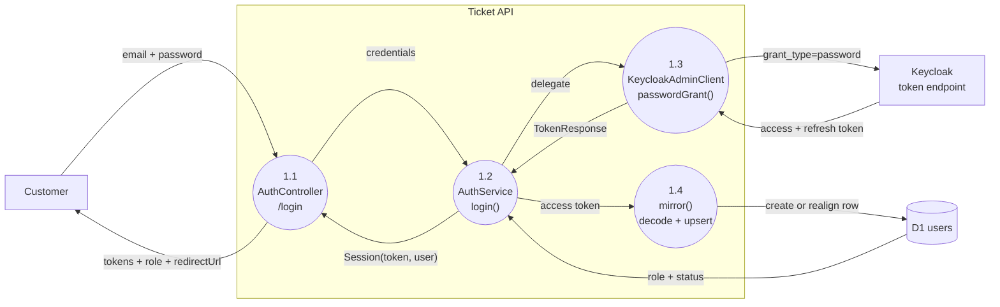
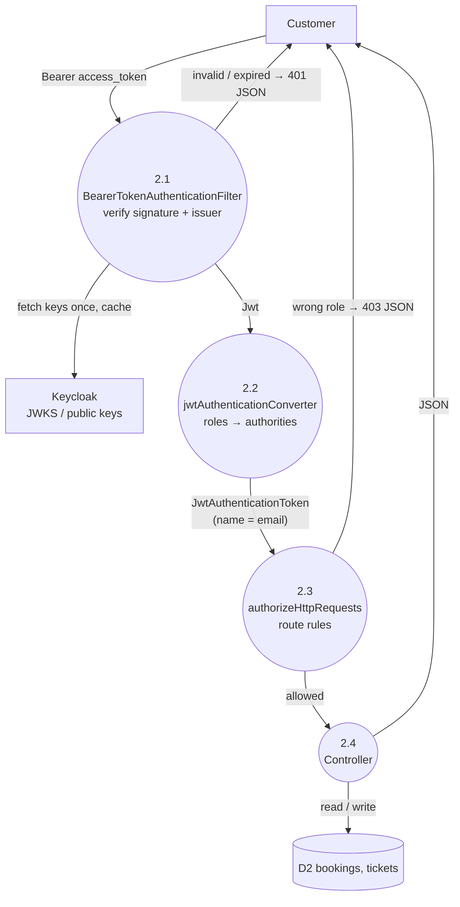

# Demo — Keycloak authentication, in three points

The whole talk in one sentence: **identity is a separate service, so this API never stores
a password and never decides who you are — it only checks a signature and a role.**

| Part | Owns | Port |
| ---- | ---- | ---- |
| Keycloak (`ticket-realm`) | passwords, roles, tokens, sessions | 8080 |
| Ticket API (Spring Boot) | movies, bookings, tickets — and it *fronts* Keycloak | 8010 |
| PostgreSQL | business data + a **mirror** of the users | 5433 |
| Ticket UI (React) | never talks to Keycloak, only to the API | 8081 |

Three points, in the order the request actually travels:

1. **Getting a token** — the API fronts Keycloak so the client never has to know it exists.
2. **Using a token** — the app is a pure OAuth2 resource server; realm roles become Spring authorities.
3. **Keeping a local row** — `users` is a mirror, not a credential store, and the back office can lock it.

---

## Point 1 — The API fronts Keycloak

`POST /login` looks like an ordinary login endpoint to the client, but the app does not
check a password — it runs Keycloak's **password grant** on the caller's behalf and hands
back the tokens Keycloak issued. `POST /register` is the same trick against Keycloak's
**Admin REST API**. So the UI has one base URL to configure, not two.

### DFD — 1.0 Get a token



### The wiring

Three classes, one job each — the controller is thin, the service holds the flow, and
exactly one class is allowed to speak HTTP to Keycloak.

[AuthController.java:42-45](src/main/java/co/tkm/ticketmanagementsystem/controller/AuthController.java#L42-L45) — takes the request, returns the tokens:

```java
@PostMapping(value = {"/login", "/api/auth/login"}, ...)
public LoginResponse login(@Valid @RequestBody LoginRequest req) {
    AuthService.Session session = authService.login(req.email(), req.password());
    return LoginResponse.of(session);
}
```

[AuthService.java:43-46](src/main/java/co/tkm/ticketmanagementsystem/service/AuthService.java#L43-L46) — Keycloak first, mirror second:

```java
public Session login(String email, String password) {
    TokenResponse token = keycloak.passwordGrant(normalize(email), password);
    return new Session(token, mirror(token.accessToken()));
}
```

[KeycloakAdminClient.java:69-76](src/main/java/co/tkm/ticketmanagementsystem/service/KeycloakAdminClient.java#L69-L76) — the actual OAuth2 call:

```java
public TokenResponse passwordGrant(String username, String password) {
    MultiValueMap<String, String> form = new LinkedMultiValueMap<>();
    form.add("grant_type", "password");
    form.add("client_id", properties.loginClientId());   // ticket-app, public client
    form.add("username", username);
    form.add("password", password);
    return requestToken(form, "Invalid email or password");
}
```

Worth saying out loud during the demo:

- **Register rolls back.** `AuthService.register()` creates the Keycloak user *first*
  (it is the system of record); if the local mirror insert then fails, it calls
  `keycloak.deleteUser(...)` so the realm is not left holding an orphan account.
- **Changing a password never touches a hash.** `changePassword()` verifies the old
  password by *logging in with it*, then resets the credential through the Admin API.
- **The app has its own Keycloak identity.** Admin API calls use the `ticket-backend`
  confidential client's service account, whose token is cached until 20s before it expires
  (`adminToken()`), not re-fetched per request.

---

## Point 2 — After login, it is only a signed token and a role

Nothing is stored between requests: no session, no cookie, no `remember-me`. Each request
carries `Authorization: Bearer <access_token>`, Spring validates the signature against the
realm's published public keys, and the roles inside the token become the authorities the
route rules already used.

### DFD — 2.0 Serve an authenticated request



### The wiring

[SecurityConfig.java:57-91](src/main/java/co/tkm/ticketmanagementsystem/config/SecurityConfig.java#L57-L91) — stateless, no login form, no logout filter, just a resource server:

```java
http
    .csrf(AbstractHttpConfigurer::disable)                 // no cookie = nothing to forge
    .sessionManagement(sm -> sm.sessionCreationPolicy(SessionCreationPolicy.STATELESS))
    .logout(AbstractHttpConfigurer::disable)               // POST /logout is our endpoint
    .authorizeHttpRequests(auth -> auth
        .requestMatchers(HttpMethod.POST, "/login", "/register", "/logout").permitAll()
        .requestMatchers("/bookings/my-bookings", "/profile/**").authenticated()
        .requestMatchers("/admin/**").hasRole("ADMIN")
        .anyRequest().authenticated())
    .oauth2ResourceServer(oauth2 -> oauth2
        .jwt(jwt -> jwt.jwtAuthenticationConverter(jwtAuthenticationConverter()))
        .authenticationEntryPoint(jsonAuthenticationEntryPoint(objectMapper))
        .accessDeniedHandler(jsonAccessDeniedHandler(objectMapper)))
    .addFilterAfter(new KeycloakUserSyncFilter(userService, objectMapper),
                    BearerTokenAuthenticationFilter.class);
```

Two decisions in that converter are the reason **no existing code had to change**
([SecurityConfig.java:106-115](src/main/java/co/tkm/ticketmanagementsystem/config/SecurityConfig.java#L106-L115)):

```java
private Converter<Jwt, AbstractAuthenticationToken> jwtAuthenticationConverter() {
    return jwt -> new JwtAuthenticationToken(jwt, authorities(jwt), KeycloakClaims.email(jwt));
}

private Collection<GrantedAuthority> authorities(Jwt jwt) {
    return KeycloakClaims.realmRoles(jwt).stream()
            .map(role -> "ROLE_" + role.toUpperCase())     // customer → ROLE_CUSTOMER
            .map(role -> (GrantedAuthority) new SimpleGrantedAuthority(role))
            .toList();
}
```

- Realm roles arrive lower-case under `realm_access.roles`; upper-casing them means every
  existing `hasRole("ADMIN")` rule keeps working untouched.
- **The principal name is the email, not Keycloak's `sub`**, because every controller and
  service resolves the current user with `authentication.getName()` against `users.email`.

What the token looks like, and the one place the app admits to knowing that shape
([KeycloakClaims.java](src/main/java/co/tkm/ticketmanagementsystem/security/KeycloakClaims.java)):

```json
{ "iss": "http://localhost:8080/realms/ticket-realm",
  "email": "admin@gmail.com",
  "realm_access": { "roles": ["customer", "admin"] } }
```

Security rejects a request inside a *filter*, before any `@RestControllerAdvice` runs, so
`SecurityConfig` writes the 401/403 body itself — in the same `{"error": ..., "type": ...}`
shape `ApiExceptionHandler` uses everywhere else, so a client parses one format.

| Status | When |
| ------ | ---- |
| 401 | No token, or malformed / expired / not signed by this realm. Also a wrong password on `/login`. |
| 403 | Valid token, missing role — or the account is suspended/banned here. |
| 409 | Registering an email that already exists in the realm. |
| 502 | Keycloak unreachable, or its `iss` does not match `issuer-uri`. |
