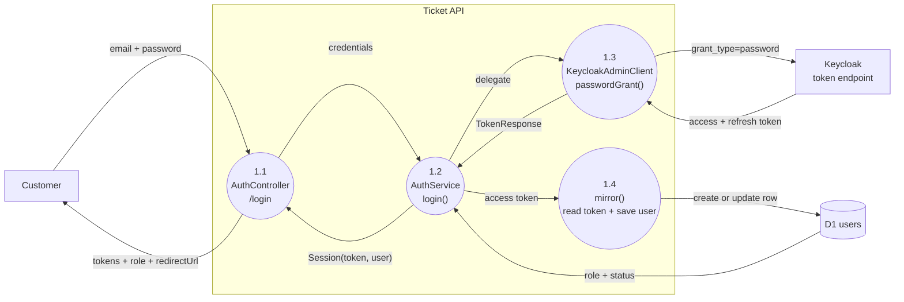

# Demo — Keycloak authentication, in two points

**The one-sentence version:** we moved login out of this app. Keycloak keeps the passwords
and hands out tokens. Our API never stores a password and never decides who you are — it
just checks that a token is real and looks at the role inside it.

| Part | What it owns | Port |
| ---- | ------------ | ---- |
| Keycloak (`ticket-realm`) | passwords, roles, tokens, sessions | 8080 |
| Ticket API (Spring Boot) | movies, bookings, tickets — and it *calls* Keycloak for the client | 8010 |
| PostgreSQL | business data + a **copy** of the user list | 5433 |
| Ticket UI (React) | never talks to Keycloak, only to our API | 8081 |

The three points follow one request from start to finish:

1. **Getting a token** — the client asks our API for a token; our API asks Keycloak.
2. **Using a token** — every later request carries the token; Spring checks it and reads the role.

---

## Point 1 — The client talks to us, we talk to Keycloak

`POST /login` looks like a normal login endpoint. But our code never compares a password.
It forwards the email and password to Keycloak using the **password grant**, and returns
the tokens Keycloak sends back. `POST /register` does the same thing against Keycloak's
**Admin REST API**.

Why do it this way? The React app only has to know **one** base URL. It never needs to know
Keycloak exists.

### DFD — 1.0 Get a token



### The code

Three classes, one job each. The controller is thin, the service holds the steps, and only
**one** class is allowed to make HTTP calls to Keycloak.

**1. The controller** takes the request and returns the tokens —
[AuthController.java:42-45](src/main/java/co/tkm/ticketmanagementsystem/controller/AuthController.java#L42-L45):

```java
@PostMapping(value = {"/login", "/api/auth/login"}, ...)
public LoginResponse login(@Valid @RequestBody LoginRequest req) {
    AuthService.Session session = authService.login(req.email(), req.password());
    return LoginResponse.of(session);
}
```

**2. The service** does two steps: ask Keycloak, then save the local copy —
[AuthService.java:43-46](src/main/java/co/tkm/ticketmanagementsystem/service/AuthService.java#L43-L46):

```java
public Session login(String email, String password) {
    TokenResponse token = keycloak.passwordGrant(normalize(email), password);
    return new Session(token, mirror(token.accessToken()));
}
```

**3. The client** makes the real OAuth2 call —
[KeycloakAdminClient.java:69-76](src/main/java/co/tkm/ticketmanagementsystem/service/KeycloakAdminClient.java#L69-L76):

```java
public TokenResponse passwordGrant(String username, String password) {
    MultiValueMap<String, String> form = new LinkedMultiValueMap<>();
    form.add("grant_type", "password");
    form.add("client_id", properties.loginClientId());   // ticket-app, public client
    form.add("username", username);
    form.add("password", password);
    return requestToken(form, "Invalid email or password");
}
```

Three details worth mentioning out loud:

- **Register undoes itself if it fails.** `AuthService.register()` creates the Keycloak user
  first, because Keycloak is the source of truth. If saving the local copy then fails, it
  calls `keycloak.deleteUser(...)` so we do not leave a half-created account behind.
- **Changing a password never touches a hash.** `changePassword()` checks the old password by
  simply *logging in with it*. If that works, it sets the new one through the Admin API.
- **Our app has its own Keycloak login.** Admin API calls use the `ticket-backend` client's
  service account. Its token is cached until 20 seconds before it expires (`adminToken()`),
  so we do not fetch a new one on every request.

---

## Point 2 — After login, it is just a signed token and a role

Nothing is remembered between requests. No session, no cookie, no "remember me". Every
request carries `Authorization: Bearer <access_token>`. Spring checks the signature using
the realm's public keys, then turns the roles inside the token into Spring authorities — the
same authorities our route rules already used before Keycloak.

### DFD — 2.0 Serve an authenticated request


### The code

[SecurityConfig.java:57-91](src/main/java/co/tkm/ticketmanagementsystem/config/SecurityConfig.java#L57-L91) —
stateless, no login form, no logout filter. Just a resource server:

```java
http
    .csrf(AbstractHttpConfigurer::disable)                 // no cookie = nothing to forge
    .sessionManagement(sm -> sm.sessionCreationPolicy(SessionCreationPolicy.STATELESS))
    .logout(AbstractHttpConfigurer::disable)               // POST /logout is our own endpoint
    .authorizeHttpRequests(auth -> auth
        .requestMatchers(HttpMethod.POST, "/login", "/register", "/logout").permitAll()
        .requestMatchers("/bookings/my-bookings", "/profile/**").authenticated()
        .requestMatchers("/admin/**").hasRole("ADMIN")
        .anyRequest().authenticated())
    .oauth2ResourceServer(oauth2 -> oauth2
        .jwt(jwt -> jwt.jwtAuthenticationConverter(jwtAuthenticationConverter()))
        .authenticationEntryPoint(jsonAuthenticationEntryPoint(objectMapper))
        .accessDeniedHandler(jsonAccessDeniedHandler(objectMapper)))
    .addFilterAfter(new KeycloakUserSyncFilter(userService, objectMapper),
                    BearerTokenAuthenticationFilter.class);
```

The converter below is small, but it is **the reason we did not have to rewrite the rest of
the app** ([SecurityConfig.java:106-115](src/main/java/co/tkm/ticketmanagementsystem/config/SecurityConfig.java#L106-L115)):

```java
private Converter<Jwt, AbstractAuthenticationToken> jwtAuthenticationConverter() {
    return jwt -> new JwtAuthenticationToken(jwt, authorities(jwt), KeycloakClaims.email(jwt));
}

private Collection<GrantedAuthority> authorities(Jwt jwt) {
    return KeycloakClaims.realmRoles(jwt).stream()
            .map(role -> "ROLE_" + role.toUpperCase())     // customer → ROLE_CUSTOMER
            .map(role -> (GrantedAuthority) new SimpleGrantedAuthority(role))
            .toList();
}
```

Two choices to point at:

- Keycloak sends roles in lower case under `realm_access.roles`. We upper-case them and add
  the `ROLE_` prefix, so every existing `hasRole("ADMIN")` rule still works with no changes.
- **The principal name is the email, not Keycloak's `sub`.** Every controller and service in
  this project finds the current user with `authentication.getName()` looked up against
  `users.email`, so the name had to stay an email.

This is the token we get back, and
[KeycloakClaims.java](src/main/java/co/tkm/ticketmanagementsystem/security/KeycloakClaims.java)
is the only class that knows this shape:

```json
{ "iss": "http://localhost:8080/realms/ticket-realm",
  "email": "admin@gmail.com",
  "realm_access": { "roles": ["customer", "admin"] } }
```

One catch: security rejects a request inside a **filter**, which runs before any
`@RestControllerAdvice`. So `ApiExceptionHandler` never sees it, and `SecurityConfig` has to
write the 401/403 body itself. It uses the same `{"error": ..., "type": ...}` shape as
everything else, so the client only ever parses one format.

---
