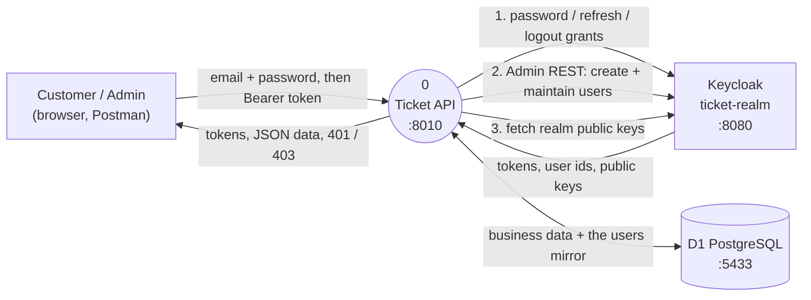
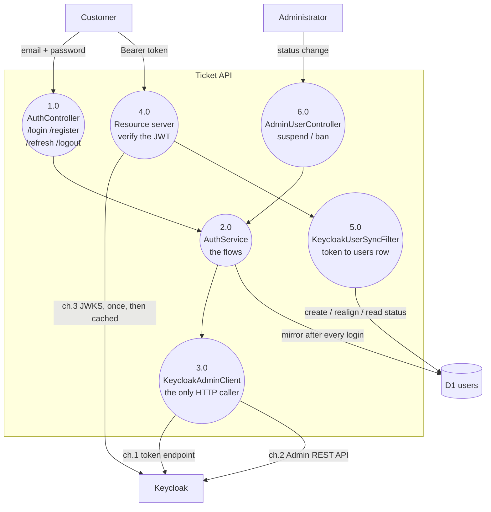
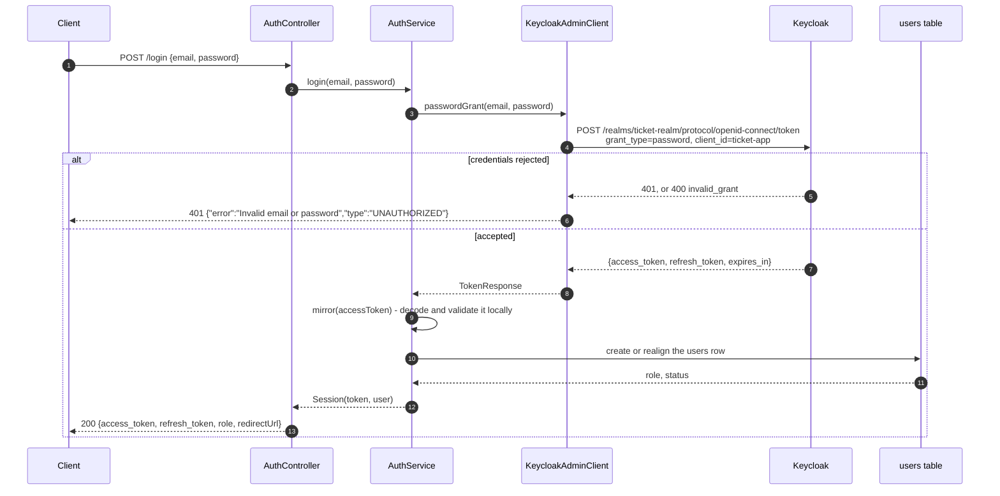
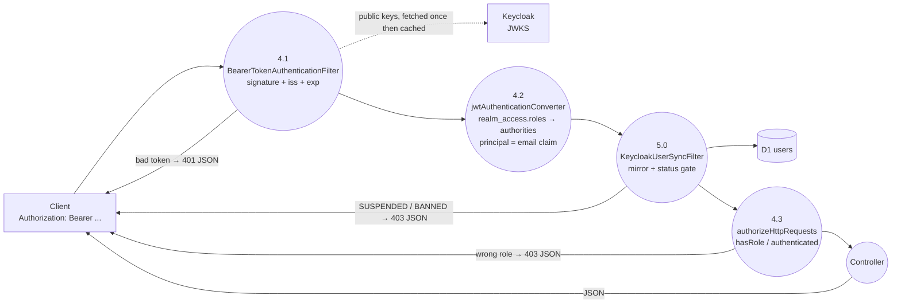
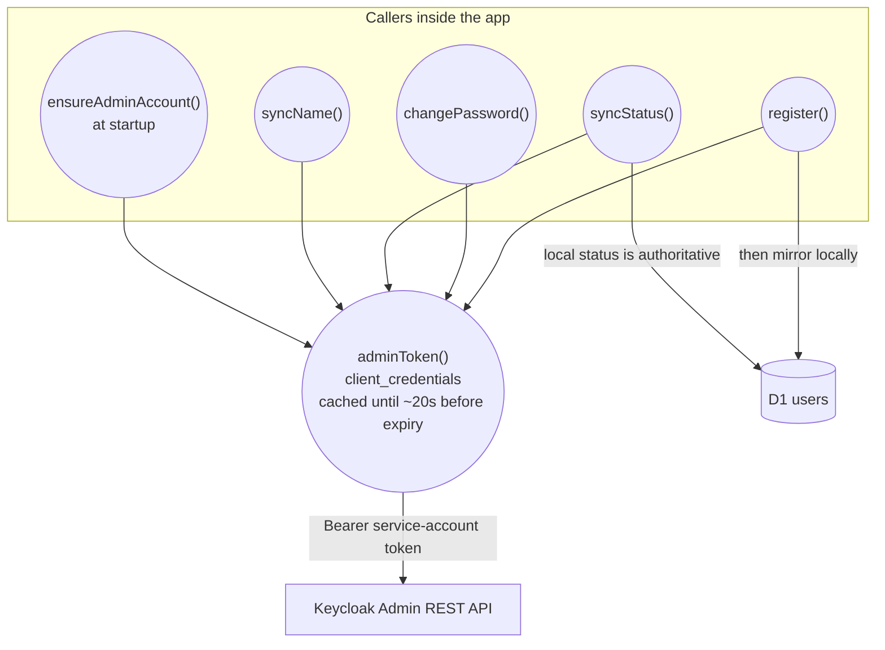

# How the API and Keycloak talk to each other

Wire-level companion to [KEYCLOAK.md](KEYCLOAK.md) (the rules) and [AUTH-DEMO.md](AUTH-DEMO.md)
(the three-point demo script). This one answers a narrower question: **which process opens
which connection, to which URL, holding which credential, and in which class.**

## The one rule that explains the whole design

**All traffic runs in one direction: the API calls Keycloak. Keycloak never calls the API,
and the browser never calls Keycloak.**

There is no redirect dance, no callback URL, no Keycloak login page. The client posts an
email and password to *this* API, and the API turns around and does the OAuth2 work on its
behalf. That is why the UI only ever needs one base URL.

Three separate channels carry that traffic, each with its own credential:

| # | Channel | Who opens it | Credential used | Keycloak side |
| - | ------- | ------------ | --------------- | ------------- |
| 1 | **Token endpoint** — login, refresh, logout | [`KeycloakAdminClient`](src/main/java/co/tkm/ticketmanagementsystem/service/KeycloakAdminClient.java#L69-L103) | the end user's email + password (public client `ticket-app`) | `/realms/{realm}/protocol/openid-connect/token` |
| 2 | **Admin REST API** — create, find, role, password, enable/disable, delete | [`KeycloakAdminClient`](src/main/java/co/tkm/ticketmanagementsystem/service/KeycloakAdminClient.java#L111-L220) | the app's own service account (confidential client `ticket-backend`) | `/admin/realms/{realm}/users/**` |
| 3 | **Public keys (JWKS)** — verifying tokens | Spring Security's resource server, not our code | none, it is a public document | `{issuer}/.well-known/openid-configuration` → `/protocol/openid-connect/certs` |

Channels 1 and 2 are the only places this app speaks Keycloak's HTTP API, and both live in
**one class on purpose** — [`KeycloakAdminClient`](src/main/java/co/tkm/ticketmanagementsystem/service/KeycloakAdminClient.java):
nothing about `RestClient` leaks out of it, callers get back plain values or a
`ResponseStatusException`.

---

## DFD Level 0 — context



Note what is **missing**: no arrow from the customer to Keycloak, and none from Keycloak
back into the API. Keycloak does not know this application exists.

---

## DFD Level 1 — the three channels, and who uses them



| Process | Class | Reaches Keycloak? |
| ------- | ----- | ----------------- |
| 1.0 | [`AuthController`](src/main/java/co/tkm/ticketmanagementsystem/controller/AuthController.java#L39-L67) | no — delegates |
| 2.0 | [`AuthService`](src/main/java/co/tkm/ticketmanagementsystem/service/AuthService.java) | no — orchestrates |
| 3.0 | [`KeycloakAdminClient`](src/main/java/co/tkm/ticketmanagementsystem/service/KeycloakAdminClient.java) | **yes**, channels 1 and 2 |
| 4.0 | Spring `oauth2ResourceServer`, wired in [`SecurityConfig`](src/main/java/co/tkm/ticketmanagementsystem/config/SecurityConfig.java#L83-L87) | **yes**, channel 3 |
| 5.0 | [`KeycloakUserSyncFilter`](src/main/java/co/tkm/ticketmanagementsystem/security/KeycloakUserSyncFilter.java#L47-L75) | no — reads the already-validated token |
| 6.0 | [`AdminUserController`](src/main/java/co/tkm/ticketmanagementsystem/controller/admin/AdminUserController.java#L52-L61) | indirectly, via 2.0 → 3.0 |

---

## DFD Level 2 — login (channel 1)



The step worth pointing at is **7 — `mirror()`**: the app decodes the token Keycloak just
issued using the very same `JwtDecoder` every later request goes through
([`AuthService.mirror`](src/main/java/co/tkm/ticketmanagementsystem/service/AuthService.java#L173-L196)).
If the realm's `iss` does not match `issuer-uri`, login fails immediately with a 502 that
says so, instead of every later request failing with a confusing 401.

```java
// AuthService.java:43-46
public Session login(String email, String password) {
    TokenResponse token = keycloak.passwordGrant(normalize(email), password);
    return new Session(token, mirror(token.accessToken()));
}
```

```java
// KeycloakAdminClient.java:69-76 - the actual HTTP call
public TokenResponse passwordGrant(String username, String password) {
    MultiValueMap<String, String> form = new LinkedMultiValueMap<>();
    form.add("grant_type", "password");
    form.add("client_id", properties.loginClientId());   // ticket-app, public
    form.add("username", username);
    form.add("password", password);
    return requestToken(form, "Invalid email or password");
}
```

---

## DFD Level 2 — an authenticated request (channel 3)



**No call to Keycloak happens on this path.** The public keys are fetched once, lazily, and
cached; after that a request is verified entirely with local CPU. That is the whole point of
a stateless resource server — Keycloak being slow or briefly down does not stop already
issued tokens from working.

The two lines that make the token usable by code written before Keycloak existed
([`SecurityConfig.java:106-115`](src/main/java/co/tkm/ticketmanagementsystem/config/SecurityConfig.java#L106-L115)):

```java
private Converter<Jwt, AbstractAuthenticationToken> jwtAuthenticationConverter() {
    return jwt -> new JwtAuthenticationToken(jwt, authorities(jwt), KeycloakClaims.email(jwt));
}

private Collection<GrantedAuthority> authorities(Jwt jwt) {
    return KeycloakClaims.realmRoles(jwt).stream()
            .map(role -> "ROLE_" + role.toUpperCase())     // customer → ROLE_CUSTOMER
            .map(role -> (GrantedAuthority) new SimpleGrantedAuthority(role))
            .toList();
}
```

The shape of the token those read is described in one place,
[`KeycloakClaims`](src/main/java/co/tkm/ticketmanagementsystem/security/KeycloakClaims.java#L34-L72):

```json
{
  "iss": "http://localhost:8080/realms/ticket-realm",
  "email": "admin@gmail.com",
  "realm_access": { "roles": ["customer", "admin"] }
}
```

And the bridge from that token to a database row
([`KeycloakUserSyncFilter.java:57-74`](src/main/java/co/tkm/ticketmanagementsystem/security/KeycloakUserSyncFilter.java#L57-L74)):

```java
User user = userService.mirrorKeycloakUser(email,
        KeycloakClaims.displayName(jwtAuthentication.getToken()),
        KeycloakClaims.role(jwtAuthentication.getToken()));

if (user.getStatus() != UserStatus.ACTIVE) {
    writeError(response, HttpStatus.FORBIDDEN,
            "This account is " + user.getStatus().name().toLowerCase() + ".");
    return;                                    // never reaches the controller
}
```

---

## DFD Level 2 — user administration (channel 2)

Everything that *changes* a user goes through the app's own service account, never the
end user's token.



```java
// KeycloakAdminClient.java:229-242 - one service-account token, reused
private synchronized String adminToken() {
    if (cachedAdminToken != null && Instant.now().isBefore(cachedAdminTokenExpiry)) {
        return cachedAdminToken;
    }
    MultiValueMap<String, String> form = new LinkedMultiValueMap<>();
    form.add("grant_type", "client_credentials");
    form.add("client_id", properties.adminClientId());
    form.add("client_secret", properties.adminClientSecret());

    TokenResponse token = requestToken(form, "This app could not authenticate against Keycloak");
    cachedAdminToken = token.accessToken();
    cachedAdminTokenExpiry = Instant.now().plusSeconds(token.expiresIn()).minus(TOKEN_REFRESH_MARGIN);
    return cachedAdminToken;
}
```

Registration is the interesting one, because it writes to **both** systems and has to undo
itself if the second write fails
([`AuthService.java:68-98`](src/main/java/co/tkm/ticketmanagementsystem/service/AuthService.java#L68-L98)):

```java
String keycloakUserId = keycloak.createUser(normalized, normalized, parts[0], parts[1],
        password, KeycloakClaims.CUSTOMER_REALM_ROLE);
try {
    return userService.mirrorKeycloakUser(normalized, name, Role.CUSTOMER);
} catch (RuntimeException e) {
    keycloak.deleteUser(keycloakUserId);   // no orphan account left in the realm
    throw e;                               // (the real code also logs if the cleanup itself fails)
}
```

Suspension writes to both too, in the other order — local first, because the local status is
the authoritative one and is enforced per request
([`AdminUserController.java:54-61`](src/main/java/co/tkm/ticketmanagementsystem/controller/admin/AdminUserController.java#L54-L61)):

```java
userService.setStatus(id, req.status());
User user = userService.findById(id);
// Disable the account in Keycloak too, so a suspended user stops being issued
// tokens rather than only being turned away at this app's door.
authService.syncStatus(user.getEmail(), req.status());
```

---

## Every Keycloak URL this app calls

`{realm}` is `ticket-realm`; the base is `keycloak.server-url`.

| Method | Keycloak path | Called by | Code |
| ------ | ------------- | --------- | ---- |
| POST | `/realms/{realm}/protocol/openid-connect/token`<br/>`grant_type=password` | `POST /login` | [`passwordGrant`](src/main/java/co/tkm/ticketmanagementsystem/service/KeycloakAdminClient.java#L69-L76) |
| POST | same, `grant_type=refresh_token` | `POST /api/auth/refresh` | [`refreshGrant`](src/main/java/co/tkm/ticketmanagementsystem/service/KeycloakAdminClient.java#L79-L85) |
| POST | same, `grant_type=client_credentials` | every Admin API call below | [`adminToken`](src/main/java/co/tkm/ticketmanagementsystem/service/KeycloakAdminClient.java#L229-L242) |
| POST | `/realms/{realm}/protocol/openid-connect/logout` | `POST /logout` | [`endSession`](src/main/java/co/tkm/ticketmanagementsystem/service/KeycloakAdminClient.java#L92-L103) |
| POST | `/admin/realms/{realm}/users` | `POST /register`, admin bootstrap | [`createUser`](src/main/java/co/tkm/ticketmanagementsystem/service/KeycloakAdminClient.java#L111-L140) |
| GET | `/admin/realms/{realm}/users?username=…&exact=true` | change password, suspend, rename | [`findUserId`](src/main/java/co/tkm/ticketmanagementsystem/service/KeycloakAdminClient.java#L143-L160) |
| GET + POST | `/admin/realms/{realm}/roles/{role}` then<br/>`/admin/realms/{realm}/users/{id}/role-mappings/realm` | granting `customer` / `admin` | [`assignRealmRole`](src/main/java/co/tkm/ticketmanagementsystem/service/KeycloakAdminClient.java#L162-L177) |
| PUT | `/admin/realms/{realm}/users/{id}/reset-password` | `POST /profile/change-password` | [`resetPassword`](src/main/java/co/tkm/ticketmanagementsystem/service/KeycloakAdminClient.java#L179-L192) |
| PUT | `/admin/realms/{realm}/users/{id}` | suspend/ban, profile rename | [`setEnabled` / `updateName`](src/main/java/co/tkm/ticketmanagementsystem/service/KeycloakAdminClient.java#L195-L220) |
| DELETE | `/admin/realms/{realm}/users/{id}` | rollback of a failed registration | [`deleteUser`](src/main/java/co/tkm/ticketmanagementsystem/service/KeycloakAdminClient.java#L203-L210) |
| GET | `{issuer-uri}/.well-known/openid-configuration`<br/>then `…/protocol/openid-connect/certs` | Spring, on the first token it sees | [`SecurityConfig`](src/main/java/co/tkm/ticketmanagementsystem/config/SecurityConfig.java#L83-L87) + `issuer-uri` |

Two details that save a support ticket each:

- **Creating a user sets `firstName`, `lastName`, `emailVerified`** on purpose. Keycloak's
  declarative user profile marks those required; an account created without them is "not
  fully set up", Keycloak fires the `VERIFY_PROFILE` required action, and the password grant
  — which cannot run an interactive action — then fails with `invalid_grant`.
- **The new user's id is read out of the `Location` header** of the 201 response
  ([`userIdFromLocation`](src/main/java/co/tkm/ticketmanagementsystem/service/KeycloakAdminClient.java#L270-L278)),
  saving a follow-up lookup.

---

## Which credential is used where

| Keycloak client | Type | Used for | Configured by |
| --------------- | ---- | -------- | ------------- |
| `ticket-app` | public | the end user's password and refresh grants | `KEYCLOAK_LOGIN_CLIENT_ID` |
| `ticket-backend` | confidential, service account with `realm-management: manage-users` | everything under `/admin/realms/**` | `KEYCLOAK_ADMIN_CLIENT_ID` + `KEYCLOAK_ADMIN_CLIENT_SECRET` |
| *(none)* | — | fetching public keys, which are public | `KEYCLOAK_ISSUER_URI` |

Both clients, the `customer`/`admin` roles and the demo accounts are defined in
[`keycloak/realm-export.json`](keycloak/realm-export.json), imported by the `keycloak`
service in [`docker-compose.yml`](docker-compose.yml) on a **fresh** container.

---

## Configuration: what points at what

Every value lives in [`.env`](.env); [`application.yml`](src/main/resources/application.yml)
is only the wiring.

| Key in `.env` | Binds to | Controls |
| ------------- | -------- | -------- |
| `KEYCLOAK_ISSUER_URI` | [`application.yml:63`](src/main/resources/application.yml#L63) → `spring.security.oauth2.resourceserver.jwt.issuer-uri` | **channel 3.** Must equal the `iss` claim in every token, exactly |
| `KEYCLOAK_SERVER_URL` | [`application.yml:72`](src/main/resources/application.yml#L72) → [`KeycloakProperties.serverUrl`](src/main/java/co/tkm/ticketmanagementsystem/config/KeycloakProperties.java#L23) | **channels 1 and 2.** Where the app *calls* Keycloak |
| `KEYCLOAK_REALM` | `keycloak.realm` | the realm segment of every URL above |
| `KEYCLOAK_LOGIN_CLIENT_ID` | `keycloak.login-client-id` | channel 1's client |
| `KEYCLOAK_ADMIN_CLIENT_ID` / `_SECRET` | `keycloak.admin-client-id` / `-secret` | channel 2's client |
| `KEYCLOAK_BOOTSTRAP_ADMIN` | [`application.yml:81`](src/main/resources/application.yml#L81) | whether [`AdminSeeder`](src/main/java/co/tkm/ticketmanagementsystem/config/AdminSeeder.java#L59-L71) pushes `APP_ADMIN_*` into the realm at startup |

**Why `KEYCLOAK_ISSUER_URI` and `KEYCLOAK_SERVER_URL` are two settings and not one:** in
Docker the app reaches Keycloak over the compose network at `http://keycloak:8080`, but
tokens are issued with `http://localhost:8080` in their `iss` so the same token also works
from Postman and Swagger on the host. Compose therefore sets `KEYCLOAK_SERVER_URL` to the
container address and `SPRING_SECURITY_OAUTH2_RESOURCESERVER_JWT_JWK_SET_URI` to the
container's key endpoint, while `issuer-uri` stays `localhost`. Running outside Docker, both
are simply `http://localhost:8080`.

---

## When the connection breaks

`KeycloakAdminClient` turns every HTTP failure into a status this API can return, so a
Keycloak problem never surfaces as an opaque 500
([`exchange`](src/main/java/co/tkm/ticketmanagementsystem/service/KeycloakAdminClient.java#L285-L308),
[`requestToken`](src/main/java/co/tkm/ticketmanagementsystem/service/KeycloakAdminClient.java#L249-L263)):

| What happened | Client sees | Message |
| ------------- | ----------- | ------- |
| Wrong email/password | 401 | `Invalid email or password` |
| Refresh token expired, revoked, already used | 401 | `Refresh token is missing, expired, or already used` |
| Email already in the realm | 409 | `Email is already in use.` |
| Keycloak down, or wrong `server-url` | 502 | `Could not reach Keycloak at …` |
| `iss` does not match `issuer-uri` | 502 | `Keycloak issued a token this app cannot validate…` |
| Service account missing `manage-users` | 502 | `…the 'ticket-backend' service account is missing the realm-management roles it needs` |
| Token missing/expired/tampered on a normal request | 401 | `The bearer token is missing, malformed, expired, or not signed by Keycloak.` |
| Valid token, insufficient role | 403 | `Your token is valid, but this endpoint requires a role you do not have.` |

The last two are written by [`SecurityConfig`](src/main/java/co/tkm/ticketmanagementsystem/config/SecurityConfig.java#L125-L146)
rather than `ApiExceptionHandler`, because Security rejects a request inside a filter, long
before any `@RestControllerAdvice` runs — they still use the same `{error, type}` body so a
client only ever parses one shape.

Two deliberate non-failures:

- **Keycloak being unreachable at startup does not stop the app.** [`AdminSeeder.ensureKeycloakAdmin`](src/main/java/co/tkm/ticketmanagementsystem/config/AdminSeeder.java#L59-L71)
  logs a warning and carries on.
- **`syncStatus` / `syncName` failures are swallowed too** — the local row is authoritative
  and enforced on every request either way.

---

## File map

| File | Role in the connection |
| ---- | ---------------------- |
| [`service/KeycloakAdminClient.java`](src/main/java/co/tkm/ticketmanagementsystem/service/KeycloakAdminClient.java) | The only class that opens an HTTP connection to Keycloak (channels 1 + 2) |
| [`service/AuthService.java`](src/main/java/co/tkm/ticketmanagementsystem/service/AuthService.java) | The flows: login, register, refresh, logout, change password, status/name sync, admin bootstrap |
| [`controller/AuthController.java`](src/main/java/co/tkm/ticketmanagementsystem/controller/AuthController.java) | The public doors: `/login`, `/register`, `/logout`, `/api/auth/**` |
| [`config/SecurityConfig.java`](src/main/java/co/tkm/ticketmanagementsystem/config/SecurityConfig.java) | Resource server (channel 3), role mapping, route rules, JSON 401/403 |
| [`config/KeycloakProperties.java`](src/main/java/co/tkm/ticketmanagementsystem/config/KeycloakProperties.java) | The `keycloak.*` settings, bound as a record |
| [`security/KeycloakClaims.java`](src/main/java/co/tkm/ticketmanagementsystem/security/KeycloakClaims.java) | Everything the app assumes about a token's shape, in one place |
| [`security/KeycloakUserSyncFilter.java`](src/main/java/co/tkm/ticketmanagementsystem/security/KeycloakUserSyncFilter.java) | Validated token → `users` row, plus the suspended/banned gate |
| [`service/UserService.java`](src/main/java/co/tkm/ticketmanagementsystem/service/UserService.java#L38-L56) | `mirrorKeycloakUser` — the upsert that keeps the mirror in step |
| [`config/AdminSeeder.java`](src/main/java/co/tkm/ticketmanagementsystem/config/AdminSeeder.java) | Startup bootstrap of the `APP_ADMIN_*` account in both systems |
| [`keycloak/realm-export.json`](keycloak/realm-export.json) | The realm: clients, roles, demo accounts |
| [`postman/Ticket-Auth.postman_collection.json`](postman/Ticket-Auth.postman_collection.json) | 25 requests exercising every path described here |
