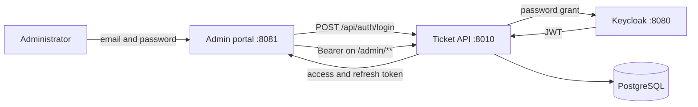
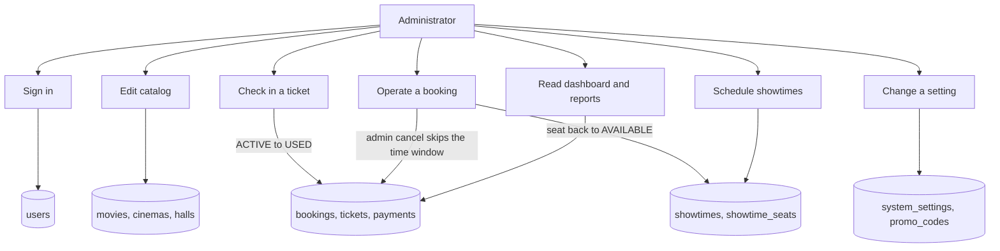

# Admin portal — analytics

Staff channel for the ticket system. Customer behavior, the ERD, and the booking DFD stay in `movie_ticket_mobile/system_analytics/SYSTEM_ANALYTICS.md`. This file only adds what an administrator does, taken from the live `/admin/**` controllers.

The portal is a browser app. It never calls Keycloak. Login is `POST /api/auth/login` on the API at port **8010**. The UI runs on **8081**, which is already the CORS origin in `application.yml`.

## Who can enter

Only a user whose JWT maps to `ROLE_ADMIN`. A `CUSTOMER` token receives 403 on every `/admin/**` route. Suspended or banned accounts are rejected at login with `ACCOUNT_BLOCKED`.

Demo account from `.env.example`: `admin@gmail.com` / `admin123`. That is the ticket-system admin, not the Keycloak console at `http://localhost:8080/admin`.

## What the portal operates

| Area | API | Rule the UI must keep |
| --- | --- | --- |
| Dashboard | `GET /admin/dashboard` | Counts, revenue today/week/month, top movies, 14-day stats, five recent bookings. Display only. |
| Movies | `GET/POST/DELETE /admin/movies` | Create and update are multipart. Poster part `imageFile`, banner part `bannerFile`. Status is `NOW_SHOWING`, `COMING_SOON`, or `ARCHIVED`. |
| Cinemas | `GET/POST/DELETE /admin/cinemas` | `id` is a UUID. Send `id` on update. |
| Halls | `GET/POST/DELETE /admin/halls` | A hall belongs to a cinema. Seat layout is generated with the hall, not drawn seat by seat in v1. |
| Showtimes | `GET/POST/DELETE /admin/showtimes` | `normalPrice` is per normal seat. `couplePrice` is per pair, not per seat. `editLocked` rows are not editable. Block and copy-next-week are separate posts. |
| Bookings | `GET /admin/bookings?q=` | Search is optional. Admin cancel is `POST /admin/bookings/{id}/cancel` and **skips** the customer cancellation window. It still frees seats and cancels tickets. It does not refund points or promo usage. |
| Check-in | `POST /admin/checkin` | Body `{ "ticketCode" }`. `ACTIVE` becomes `USED` and `scannedAt` is set. `USED` and `CANCELLED` are rejected. |
| Food | `/admin/food-items`, `/admin/food-orders` | Item save is multipart. Orders are read-only. `stockQuantity` 0 means unlimited. |
| Promos | `/admin/promo-codes` | Percent is 1–100. `maxUses` 0 means unlimited. Discount applies to checkout subtotal only, never to tax, service fee, or food. |
| Users | `/admin/users` | Status is `ACTIVE`, `SUSPENDED`, or `BANNED`. Points change is a **delta**, not a new total. |
| Notifications | `GET /admin/notifications`, `POST /admin/notifications/send` | The send body is `{ "title", "message" }` and broadcasts to everyone. Do not add a movie target until the API accepts one. |
| Settings | `GET/POST /admin/settings` | Save body is a map of key to string value. Keys: `hold_minutes`, `cancellation_hours`, `service_fee`, `tax_rate`, `weekend_surcharge_rate`, `morning_discount_rate`. |
| Reports | `GET /admin/reports`, `GET /admin/reports/export` | Export is a CSV download. Revenue figures come from the server. |

## Admin flow

## Invariants

1. The portal does not recompute checkout totals. Settings change the rates the server reads on the next quote.
2. A seat becomes `BOOKED` only after a paid confirm, and `AVAILABLE` again only after cancel. The portal has no hold button.
3. Admin cancel ignores `cancellation_hours`. Customer cancel does not.
4. Check-in never runs on a cancelled ticket and never runs twice.
5. Couple price on a showtime is the price of one pair.
6. Passwords stay in Keycloak. The users table password column is not an admin form field.
